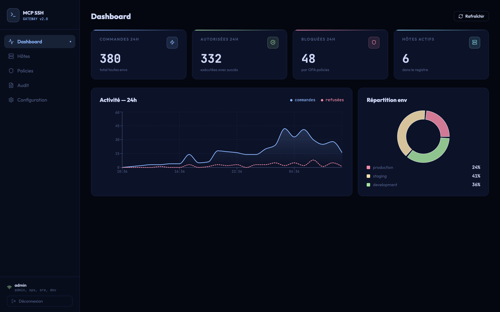
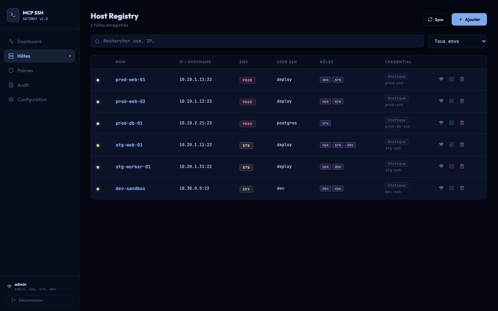

# MCP SSH Gateway

A self-hosted SSH gateway that lets Claude execute commands on your servers through the Model Context Protocol (MCP). Private keys are stored in HashiCorp Vault or CyberArk and handled in memory only. Every command is authenticated, rate-limited, filtered by policies (production runs as an allow-list), verified against pinned host keys, and audited.


*Dashboard — 24h activity, policy denials and per-environment breakdown.*


*Host Registry — hosts scoped by environment, SSH user, roles and credential backend.*

## Features

- **MCP integration** — Claude can list hosts, run commands, and read audit logs via `ssh_exec`, `ssh_list_hosts`, `ssh_audit`
- **Vault KV** — SSH private key and passphrase stored encrypted in Vault, retrieved at connection time
- **Vault SSH CA** — Alternatively, generate ephemeral ED25519 certificates (TTL 5 min) signed by Vault
- **Policy engine** — Regex rules stored in the database (shared across workers), evaluated deny > warn > allow; production runs as an **allow-list** by default
- **Audit log** — Immutable per-command log with SHA-256 stdout hash, duration, exit code, deny reason
- **RBAC** — JWT-based roles (`admin`, `ops`, `sre`, `dev`) scoped per host
- **Host key pinning** — SSH host keys verified against pinned keys (strict / TOFU), MITM-resistant
- **Rate limiting** — Per-user, per-host, per-environment (separate limits for prod / staging / dev)
- **React UI** — Dashboard, host registry, policy editor, audit viewer, SSH credential management
- **Observability** — Prometheus metrics, pre-wired Grafana stack

## Architecture

```
Claude Code
    │  MCP stdio (server.py)
    ▼
mcp_server ──HTTP──► nginx ──► gateway (FastAPI, N workers)
                                  │
                      ┌───────────┼─────────┬──────────┐
                      │           │         │          │
                   Vault or    Postgres   Redis     asyncssh
                   CyberArk    (hosts,    (rate      (SSH exec,
                   (creds,     policies,  limits,    host key
                   SSH CA)     audit)     lockout)   pinning)
```

### How a command is executed

Every `POST /exec` goes through this pipeline — each step can refuse the command, and every refusal is logged in the audit trail:

1. **Authentication** — JWT (24 h) or API token (`mcp_…`, SHA-256 hashed in DB, revocable)
2. **RBAC** — the user's roles must intersect the host's `allowed_roles` (admins bypass)
3. **Rate limit** — Redis sliding window per user × host × environment (10/30/100 cmd/min for prod/staging/dev)
4. **Policies** — regex rules from the DB, evaluated **deny > warn > allow**; in production, no matching `allow` rule means **deny** (allow-list)
5. **Host key** — the server's SSH key must match the pinned `host_key` (strict), be pinned on first use (tofu), or the command is refused
6. **Credential** — fetched from Vault KV / Vault SSH CA / CyberArk / static key, kept **in memory only**
7. **Exec + audit** — command runs with a bounded timeout (1–600 s); user, command, exit code, duration and a SHA-256 of stdout are recorded

## Quick start

```bash
git clone https://github.com/sealkrach/MCP-SSH-Gateway
cd MCP-SSH-Gateway

cp .env.example .env
# Edit .env — required:
#   JWT_SECRET   → openssl rand -hex 32   (the gateway refuses to start without it)
#   DB_PASSWORD  → any strong password
# For a local demo you can enable the built-in demo accounts:
#   ALLOW_DEFAULT_USERS=true

docker compose up --build -d
```

| Service    | URL                    |
|------------|------------------------|
| UI         | http://localhost:3000  |
| API        | http://localhost:8080  |
| Vault      | http://localhost:8200  |
| Prometheus | http://localhost:9090  |
| Grafana    | http://localhost:3001  |

Demo login (only if `ALLOW_DEFAULT_USERS=true`): `admin / admin123`.
For anything beyond a local demo, create real users — see [Users](#users).

## SSH modes

### `vault-kv` (recommended)

Store your private key in Vault via the UI (Settings → SSH / Vault → Vault KV):

1. Paste your PEM private key
2. Enter passphrase (optional)
3. Click **Stocker dans Vault**
4. Set `SSH_MODE=vault-kv` in `.env` and restart:

```bash
docker compose up -d gateway
```

### `vault` — Vault SSH CA (production)

Vault signs ephemeral ED25519 certificates per connection. Requires a configured Vault SSH secrets engine:

```bash
vault secrets enable -path=ssh ssh
vault write ssh/roles/dev-ssh \
  key_type=ca allow_user_certificates=true \
  default_user=deploy ttl=5m
```

Then set `SSH_MODE=vault` and configure `VAULT_URL`, `VAULT_TOKEN`, `VAULT_MOUNT` in `.env`.

### `key` — static key (dev only)

Mounts `~/.ssh/id_rsa` from the host. Set `SSH_MODE=key` (default).

## Connecting Claude Code

```bash
# Recommended: create an API token in the UI (API Tokens tab) and use MCP_SSH_TOKEN
claude mcp add ssh-gateway \
  -e MCP_SSH_GATEWAY_URL=http://localhost:8080 \
  -e MCP_SSH_TOKEN=mcp_... \
  -- python3 /path/to/MCP-SSH-Gateway/mcp_server/server.py

# Or with username/password (demo accounts need ALLOW_DEFAULT_USERS=true)
claude mcp add ssh-gateway \
  -e MCP_SSH_GATEWAY_URL=http://localhost:8080 \
  -e MCP_SSH_USER=admin \
  -e MCP_SSH_PASS=admin123 \
  -- python3 /path/to/MCP-SSH-Gateway/mcp_server/server.py
```

Verify the connection:

```bash
claude mcp list
# ssh-gateway: python3 ... - ✓ Connected
```

Claude can then:

```
List my SSH hosts
Run "df -h" on prod-web-01
Show me the last 20 audit entries
```

## Available MCP tools

| Tool | Description |
|------|-------------|
| `ssh_exec(host, command, timeout?)` | Execute a command on a registered host |
| `ssh_list_hosts(env?)` | List accessible hosts, optionally filtered by environment |
| `ssh_audit(limit?, env?, status?)` | Query the audit log |

## API reference

```
POST /auth/token          Login → JWT
GET  /auth/me             Current user

GET  /hosts               List hosts
POST /hosts               Create host (admin)
PUT  /hosts/{id}          Update host (admin)
DELETE /hosts/{id}        Disable host (admin)

POST /exec                Execute SSH command

GET  /policies            List policies (admin)
POST /policies            Create policy (admin)
PUT  /policies/{id}       Update policy (admin)
DELETE /policies/{id}     Delete policy (admin)

POST /vault/credentials           Store SSH key in Vault (admin)
GET  /vault/credentials/status    Check if key is stored
DELETE /vault/credentials         Remove key from Vault (admin)

GET  /audit               Audit log (admins see all; others see only their own entries)
GET  /metrics/summary     Dashboard metrics
GET  /metrics/prometheus  Prometheus scrape endpoint
GET  /health              Health + Vault status
```

## Configuration

All settings via `.env` (see `.env.example`):

| Variable | Default | Description |
|----------|---------|-------------|
| `JWT_SECRET` | — | Secret key for JWT signing (32+ chars, **required** — startup fails otherwise) |
| `JWT_EXPIRE_HOURS` | `24` | Token lifetime |
| `ALLOW_DEFAULT_USERS` | `false` | `true` enables the demo accounts (local dev only) |
| `DB_PASSWORD` | — | PostgreSQL password (**required**) |
| `SSH_MODE` | `key` | `key` / `vault-kv` / `vault` / `cyberark` |
| `SSH_HOST_KEY_POLICY` | `strict` | `strict` / `tofu` / `insecure` — host key verification (compose default: `tofu`) |
| `POLICY_PROD_DEFAULT` | `deny` | `deny` = production is an allow-list; `allow` = legacy fail-open |
| `CORS_ORIGINS` | — | Comma-separated allowed origins; empty = no CORS (UI is same-origin) |
| `LOGIN_MAX_FAILS` | `5` | Failed logins per user+IP before lockout |
| `LOGIN_LOCKOUT_SECONDS` | `900` | Lockout duration |
| `VAULT_URL` | `http://vault:8200` | Vault address |
| `VAULT_TOKEN` | `dev-only-token` | Vault root/service token |
| `VAULT_KV_MOUNT` | `secret` | Vault KV v2 mount |
| `VAULT_KV_PATH` | `mcp-gateway/ssh-key` | Path for stored SSH key |
| `RATE_PROD` | `10` | Max commands/min in production |
| `RATE_STG` | `30` | Max commands/min in staging |
| `RATE_DEV` | `100` | Max commands/min in development |
| `GATEWAY_PORT` | `8080` | Gateway API port |
| `UI_PORT` | `3000` | UI port |

## Users

Define users in a `users.json` file (or the `GATEWAY_USERS` env var, same JSON format) with **bcrypt-hashed** passwords:

```bash
python -m gateway.hash_password
# → $2b$12$...
```

```json
[
  {"username": "admin", "password_hash": "$2b$12$...", "roles": ["admin", "ops", "sre", "dev"]},
  {"username": "ops",   "password_hash": "$2b$12$...", "roles": ["ops", "sre"]}
]
```

A plaintext `"password"` field is still accepted for local dev, but logs a warning — use `password_hash`.

### Demo accounts (opt-in)

With `ALLOW_DEFAULT_USERS=true` and no `users.json`/`GATEWAY_USERS`, these demo accounts are active. **Never enable in production.**

| Username | Password | Roles |
|----------|----------|-------|
| `admin` | `admin123` | admin, ops, sre, dev |
| `ops` | `ops123` | ops, sre |
| `dev` | `dev123` | dev |

## SSH host key verification

Each host's public key is pinned in the `host_key` field (authorized_keys format). `SSH_HOST_KEY_POLICY` controls the behavior:

- `strict` (default) — exec is refused (HTTP 428) until a `host_key` is set for the host
- `tofu` — the key is fetched and pinned on first exec (docker-compose default); later changes are rejected
- `insecure` — no verification (local dev only, logs a warning)

Get a host's key with `ssh-keyscan -t ed25519 <hostname>` and set it via `PUT /hosts/{id}`.

## Policies

Rules are stored in the **database** (shared by all workers; a `policies.json` from older versions is imported automatically on first start). Evaluation order is **deny > warn > allow** — a deny rule can never be masked by an allow rule.

**Production is an allow-list by default** (`POLICY_PROD_DEFAULT=deny`): a command that matches no `allow` rule is refused. Staging and development stay fail-open. Set `POLICY_PROD_DEFAULT=allow` to restore the legacy behavior (regex blacklists are easy to bypass — not recommended).

Default deny rules: `rm -rf` (and variants), `sudo`/`su`, interactive shells, direct DB access, `curl|bash`, `chmod 777`, reboot/shutdown. One default `allow` rule covers common read-only ops (`df`, `ls`, `cat`, `ps`, `systemctl status`, …).

Rules are editable in the UI (Policies tab, **admin only** — deny patterns reveal how to evade them) or via the API. Changes propagate to other workers within ~10 s (`POLICY_CACHE_TTL`).

## Kubernetes

```bash
docker build -t registry.example.com/mcp-ssh-gateway:2.0 .
docker push registry.example.com/mcp-ssh-gateway:2.0

helm upgrade --install mcp-ssh ./helm \
  --set image.repository=registry.example.com/mcp-ssh-gateway \
  --set env.JWT_SECRET=your-32-char-secret \
  --set database.password=your-db-password \
  --set gatewayUsers='[{"username":"admin","password_hash":"$2b$12$...","roles":["admin"]}]' \
  --set ingress.host=mcp-ssh.example.internal
```

`gatewayUsers` is required to be able to log in (demo accounts are disabled by default); generate the bcrypt hash with `python -m gateway.hash_password`. The chart defaults to `SSH_HOST_KEY_POLICY=strict` and `POLICY_PROD_DEFAULT=deny`.

## Local development (without Docker)

```bash
python3 -m venv .venv && source .venv/bin/activate
pip install -r requirements.txt

# Terminal 1 — gateway API on :8080 (SQLite, demo accounts, TOFU host keys)
export JWT_SECRET=$(openssl rand -hex 32)
export ALLOW_DEFAULT_USERS=true SSH_HOST_KEY_POLICY=tofu
uvicorn gateway.main:app --port 8080 --reload

# Terminal 2 — React UI on :5173 (proxies /api → :8080)
cd ui && npm ci && npm run dev
```

Redis and Vault are optional in dev: without Redis the rate limiter and login lockout fall back gracefully; `SSH_MODE=key` uses a local private key (`SSH_KEY_PATH`).

## Project structure

```
gateway/            FastAPI backend
  main.py           App, hosts CRUD, /exec pipeline, audit, metrics, SPA
  auth.py           JWT + API tokens, bcrypt users, login lockout
  policy.py         DB-backed policy engine (deny > warn > allow)
  vault_ssh.py      Vault KV / Vault SSH CA credential provider (in-memory keys)
  cyberark_ssh.py   CyberArk CCP / PVWA credential provider
  hash_password.py  bcrypt hash helper (python -m gateway.hash_password)
  db.py             Async SQLAlchemy engine/session
mcp_server/         MCP stdio server for Claude Code (ssh_exec, ssh_list_hosts, ssh_audit)
ui/                 React + Vite single-page app
helm/               Kubernetes chart
vault/              Vault dev-mode config + auto-init/unseal entrypoint
```

## Troubleshooting

| Symptom | Cause / fix |
|---|---|
| Gateway exits at startup with `JWT_SECRET manquant…` | Set a real `JWT_SECRET` (`openssl rand -hex 32`) in `.env` |
| `401 Identifiants incorrects` on a fresh install | No users configured: create `users.json` / `GATEWAY_USERS`, or set `ALLOW_DEFAULT_USERS=true` for a local demo |
| `429 Trop de tentatives` | Login lockout (5 fails/15 min per user+IP, 20 per user) — wait or flush the `login_fail:*` keys in Redis |
| `/exec` returns **428** | `SSH_HOST_KEY_POLICY=strict` and the host has no pinned key: set `host_key` (`ssh-keyscan -t ed25519 <host>`) or switch to `tofu` |
| `/exec` denied with *“Production en mode allow-list”* | Expected: prod only runs commands matching an `allow` rule — add one, or set `POLICY_PROD_DEFAULT=allow` |
| Policies tab shows 403 | Policy management is admin-only by design |
| A policy change doesn't apply immediately | Worker caches refresh within ~10 s (`POLICY_CACHE_TTL`) |
| Host key changed legitimately (server reinstalled) | Update `host_key` via `PUT /hosts/{id}` with the new public key |

## Security notes

- **Never commit `.env`** — it is in `.gitignore`. Use secrets management in production.
- The gateway refuses to start if `JWT_SECRET` is missing, shorter than 32 chars, or equal to a published example value.
- Demo accounts are disabled unless `ALLOW_DEFAULT_USERS=true` — never enable it outside a local demo.
- Keep `SSH_HOST_KEY_POLICY=strict` (or at least `tofu`) in production; `insecure` disables MITM protection.
- Keep `POLICY_PROD_DEFAULT=deny` — production allow-list. Regex deny rules alone are bypassable.
- Login is locked for 15 min after 5 failures per user+IP (Redis-backed).
- Private keys from Vault KV / Vault CA / CyberArk are handled **in memory only** (never written to disk).
- The dev-mode Vault token (`dev-only-token`) is now scoped (own KV subtree + SSH signing, not root) and port 8200 binds to localhost only — still replace it with a real token in production.
- Nginx sends security headers (CSP, nosniff, frame deny); terminate TLS in front and enable HSTS for any non-local deployment.
- `SSH_MODE=key` mounts your host SSH key into the container — use `vault-kv` or `vault` in production.
